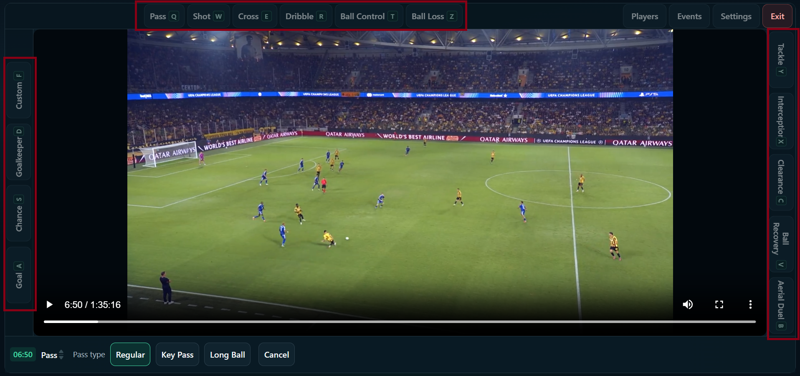
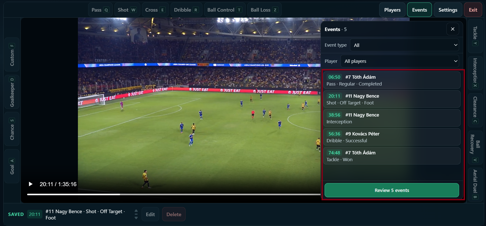

# MatchMark

A local-first football video tagging and review tool for youth coaches, smaller clubs, analysts and scouts. Built with React and TypeScript.

[Run locally](#running-locally) · [Screenshots](#screenshots) · [Architecture](#architecture)

## Overview

MatchMark helps you mark football events while watching a local match video, assign players and revisit relevant moments. It runs in the browser without an account or backend. Analysis can be exported as JSON and resumed later by importing the session and reattaching the video.

## Why I built it

After more than a decade working in football scouting and video analysis, I wanted to build a straightforward tool for the everyday work of coaches and analysts at smaller clubs. The focus is quick tagging, useful review and keeping video files on the user's device.

## Key Features

- **Local video analysis:** load MP4/WebM files with native playback controls; Exit/Resume preserves your place and draft within the current page session.
- **Structured tagging:** 15 event types with relevant subtypes, outcomes, body parts or a Custom description. Save explicitly, then edit or delete the latest saved event.
- **Player management:** add, edit and delete roster entries; assign players to events. Historical events survive player deletion.
- **Keyboard controls:** configurable event shortcuts, saved in localStorage; Quick Seek moves by 1.2, 1.5 or 2 seconds using physical `2`/`3`/`4` keys. Hold Shift to move backward. Ctrl+Enter / Cmd+Enter saves a completed event form.
- **Filtering and Review:** combine event-type and player filters, seek to exact event timestamps, or use Previous/Next in Review with a three-second lead-in.
- **Portable sessions:** versioned JSON export/import, runtime validation and video reattachment with filename, size and duration comparison plus mismatch warnings.
- **Accessibility:** native import/help dialogs, explicit focus transitions, named controls and field-linked validation messages.

**Event types:** Pass, Shot, Cross, Dribble, Ball Control, Ball Loss, Goal, Chance, Goalkeeper, Custom, Tackle, Interception, Clearance, Ball Recovery and Aerial Duel.

All types require a player except Custom, which allows an unassigned note. Event fields and labels come from [central event definitions](src/config/eventDefinitions.ts).

## Session Workflow

1. Choose a local video, tag events and manage the roster.
2. Select **Settings → Export session** before closing the browser.
3. Later, use **Import session** and confirm replacement of the current analysis.
4. Choose **Reattach video** and select the original local file.
5. Review the comparison, then select **Continue analysis** or explicitly accept a mismatch with **Use this video anyway**.

The JSON contains saved events, players, video metadata and ID allocators, **not the video itself**. Metadata comparison is a matching hint, not proof of file identity. Reattachment preserves the imported analysis data.

## Tech Stack

| Area | Technology |
| --- | --- |
| UI | React 19, TypeScript 6 in strict mode |
| Tooling | Vite 8, Oxlint |
| Styling | Plain CSS, custom properties and responsive media queries |
| Browser APIs | File API, HTML video, Blob/Object URLs, native dialog, localStorage |
| Tests | Node.js built-in test runner and a custom component-handler harness |

No backend, database or external state-management library is required.

## Architecture

[VideoPlayer](src/components/VideoPlayer.tsx) coordinates the workflow and connects three focused hooks to presentation components:

| Boundary | Responsibility |
| --- | --- |
| [useMatchSession](src/hooks/useMatchSession.ts) | Events, roster, CRUD, monotonic ID allocation and imported domain data |
| [useVideoSource](src/hooks/useVideoSource.ts) | Local files, active/probe Object URL ownership, metadata and cleanup |
| [useAnalysisShortcuts](src/hooks/useAnalysisShortcuts.ts) | Global event-tagging and Quick Seek listeners with separate enablement rules |
| [Components](src/components/) | VideoPicker, event forms, panels and Review controls |
| [Pure utilities](src/utils/) | Validation, filtering, session snapshots/serialization and video comparison |

The event model is a TypeScript discriminated union. Runtime import validation checks external JSON independently of compile-time types. Deleted IDs are not recycled; imported allocators also account for historical player references.

Styles are split between app/workspace layout in `App.css`, global foundations in `index.css` and [feature stylesheets](src/styles/).

## Testing and Code Quality

Automated tests cover domain operations, event payloads, filtering, shortcut guards, session roundtrips, invalid imports, allocator conflicts, Object URL cleanup and failure paths. Accessibility tests check markup and handlers.

```sh
npm test
npm run lint
npm run build
```

The build includes TypeScript checking. Component tests simulate hooks and media rather than rendering a browser DOM; native dialog focus containment, Tab order, screen-reader announcements and responsive visuals still require browser checks.

## Privacy and Local-First Design

The selected video stays on your device. MatchMark plays it through a browser Object URL and does not upload it to a backend. Session JSON stores analysis data and video metadata, not video bytes or reusable blob URLs.

Only event-shortcut settings persist automatically in localStorage. Keep exported session files to retain your analysis between browser sessions.

## Screenshots

Annotated screenshots from the in-app guide:

**Tagging workspace and event-specific details**



**Events panel: filtering, saved timestamps and the entry point to Review**



## Running Locally

Use Node.js 24 and npm, a modern browser, and a local match video. MP4 with H.264 is recommended; codec support depends on the browser.

```sh
git clone https://github.com/nviliam/MatchMark.git
cd MatchMark
npm install
npm run dev
```

Open the local URL printed by Vite and select your video. On PowerShell, use `npm.cmd` if script policy blocks `npm.ps1`.

## Current Limitations

- No analysis autosave or refresh recovery. Export saved work before refreshing or closing the page; drafts and playback position are not included in the JSON.
- No accounts, backend or cloud sync. Imported sessions require manual video reattachment, and metadata matching is not cryptographic verification.
- Selecting another video through the normal picker starts fresh event history while retaining the roster.
- No rendered video clips, statistics dashboard or automatic event detection.

## Roadmap

Planned directions from [development ideas](docs/IDEAS.md):

- IndexedDB autosave and recovery.
- A library of saved analyses.
- Event/player/outcome summaries and CSV export.
- Review shortcuts and configurable lead-in time.

## Author

Built by **Viliam Nagy**, drawing on more than a decade of football scouting and video-analysis experience.

[GitHub](https://github.com/nviliam)
